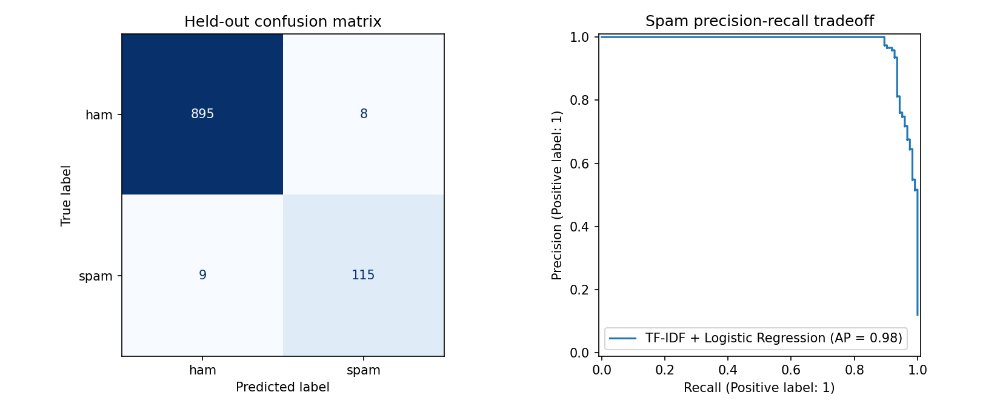

# English SMS Spam Detection

[](LICENSE)


Classify English SMS messages as ham or spam using TF-IDF word/bigram features and Logistic Regression.

شرح مختصر بالمصري في [EXPLAIN_AR.md](EXPLAIN_AR.md).

## Dataset, questions and method

**Data:** real UCI SMS Spam Collection, Almeida and Hidalgo (2011), 5,574 raw records in the downloaded text file. Source: https://archive.ics.uci.edu/dataset/228/sms%2Bspam%2Bcollection . DOI: 10.24432/C5CC84. Some mirrors report 5,572 records; code reports the actual downloaded file count. Attribution, provenance and the original dataset readme with copyright/no-warranty terms are included in `data/`. Raw corpus can contain phone numbers and spam URLs; treat them only as dataset text, never follow them.

**Method:** canonicalize lowercase/whitespace/digit variants, remove duplicate canonical keys before splitting, discard conflicting-label keys if present. Stratified 80/20 train/test split, seed 42. Pipeline learns TF-IDF vocabulary and IDF only in training folds. Five-fold stratified CV selects LogisticRegression C from 0.5, 1 and 4 using spam F1. Class weights are balanced. Report spam precision/recall/F1, accuracy, confusion matrix and precision-recall curve alongside a majority baseline. No test-threshold tuning.

**Limits:** canonical deduplication reduces exact/template-number leakage but does not guarantee semantic, sender-level or temporal separation. Historical English SMS does not represent Egyptian Arabic or present-day WhatsApp scams. Model scores are uncalibrated. Review suspected spam; never auto-delete based only on this prototype. Vocabulary weights are associations, not a proof that a word is spam.

## Setup

Tested with Python 3.10.12. Use Python 3.10 or 3.11 and a fresh virtual environment.
Run the following **inside this project folder**:

```bash
python -m venv .venv
# Windows PowerShell:
.venv\Scripts\Activate.ps1
# macOS / Linux:
source .venv/bin/activate
python -m pip install -r requirements.txt
python main.py
```

Choose only the activation command for your operating system. If PowerShell blocks activation,
you can use `.venv\Scripts\python.exe` instead of `python` for each command.
All input data is included or comes bundled with scikit-learn; running requires no account,
API key, paid service or dataset download. Installing dependencies needs an internet connection.
The pinned requirements record the tested direct dependencies, not every transitive dependency.
All paths are relative to the script, so main.py also works when launched elsewhere.

## Repository map

- `main.py`: commented, reproducible analysis/training pipeline.
- `data/`: original data or dataset description and attribution.
- `outputs/`: actual generated reports, metrics, charts and run log.
- `EXPLAIN_AR.md`: short Egyptian-Arabic walkthrough and interview prompts.
- `requirements.txt`: tested direct package versions.

Results below are from the included reproducible run, not invented targets.

## Try an English message

```bash
python predict.py --text "See you at the library tomorrow"
```

Runs locally and prints ham/spam plus an uncalibrated score. It does not send messages or contact anyone. `outputs/error_analysis.csv` lists mistaken held-out row IDs without copying spam links or phone numbers. To inspect an error, use the cleaned frame from main.load_clean() and its row ID. Only load trusted joblib files. The model matches the train/test evaluation, not a refit on all messages.

## Reproduced results

### English SMS spam results

- 5574 raw lines; 5135 canonical unique messages after cleaning.
- 4108 training messages; 1027 test messages, including 124 spam.
- Test spam precision: 0.935; recall: 0.927; F1: 0.931.
- Test accuracy: 0.983; majority baseline accuracy: 0.879.
- Majority baseline spam F1: 0.000; 5-fold training CV spam F1: 0.937.

Majority accuracy hides the minority-spam problem, so precision, recall and F1 matter.
Canonical keys lowercase text, normalize whitespace and replace digit sequences; each key
is kept once before splitting, and conflicting-label keys are discarded. No key appears
in both splits. Semantically similar templates may still remain; this is not a temporal,
sender-held-out or real deployment benchmark. Vocabulary and IDF fit only on training folds.
Scores are not calibrated probabilities. Decision threshold is the model default (0.5);
the precision-recall plot is diagnostic, not a threshold tuned against the test set.
Historical English SMS is different from Egyptian Arabic, WhatsApp and current scams.
Do not auto-delete messages. Review false positives and never follow links in raw spam data.


## Tests and next steps

The downloadable five-project review bundle contains the integration test suite. This standalone repository can be verified with `python main.py` and its saved report. To rerun only this project: `python main.py`.

Before presenting this as your own work, understand each cleaning choice, explain every metric, and add a change you can defend. This is a ready-to-study portfolio starter, not a claim of client work or original data collection.

## Bundled data and reports

Real datasets and generated reports are compressed in the root `13-project-assets.zip` file.
`resources.py` verifies its SHA-256 and extracts it automatically the first time you run
`main.py` or the dashboard. No web request is made. A numeric prefix on the archive filename
is harmless and supported. You can also run `python resources.py` explicitly before browsing
the output images locally. Saved joblib models are not published; run main.py to train them.
The full data-source notes and original notices remain inside the archive.

## Project preview


